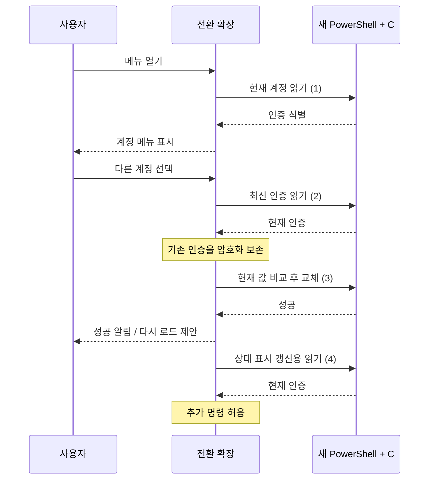
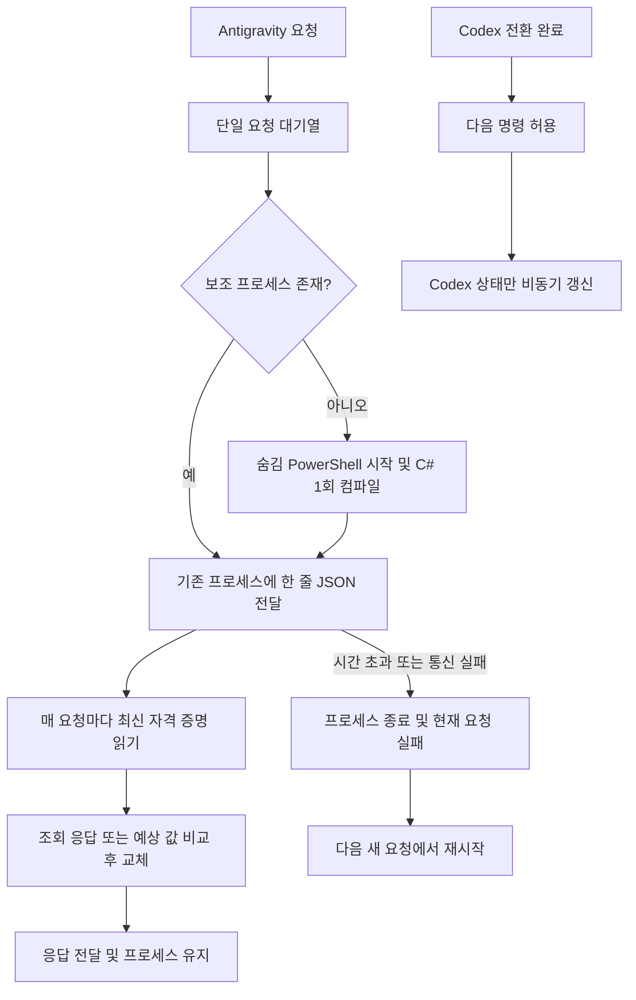

# 계정 전환 지연 분석

- 작성 일시: 2026-10-30 18:36:05 KST
- 범위: 지연 원인 조사 및 PowerShell 재사용·에이전트별 상태 갱신 구현.
- 상태: 구현 및 빌드·회귀 검증 완료.

## 수정 전 원인

1. `src/extension.ts:159`에서 현재 인증 조회가 끝나야 계정 선택 메뉴를 표시한다. Antigravity는 이 조회마다 PowerShell 프로세스를 시작하고 `Add-Type`으로 C#을 컴파일한다(`src/agents/antigravity.ts:45`, `:121`).
2. 서로 다른 Antigravity 계정으로 전환할 때 메뉴 진입 조회, `Accounts.switchTo()`의 최신 인증 읽기, 교체 프로세스, 마지막 상태 갱신까지 보통 총 4회 실행한다. 교체 프로세스 내부의 현재 값 비교는 외부 변경 감지에 필요하다.
3. 명령 종료 시 모든 에이전트 상태를 갱신한 뒤에야 `busy`를 해제한다(`src/extension.ts:186`). Codex만 전환하거나 메뉴를 취소해도 등록된 Antigravity의 느린 조회를 기다린다. 성공 알림은 이 마지막 갱신 전에 표시되지만 추가 조작은 막힌다.
4. 계정 목록을 메뉴, 전환, 전체 상태 갱신에서 다시 읽는다. 암호화 저장소 비용은 측정하지 않았으며, 전환 직전 재조회는 다른 창의 변경을 반영하는 데 필요하다.
5. 인증 교체와 대상 확장의 로그인 반영은 별개다. 현재 구현은 성공 알림에서 창 다시 로드를 제안하며, 대상 확장의 메모리 인증을 직접 갱신하지 않는다.

## 측정 근거와 한계

- 기존 스크립트에서 요청 처리 이전의 초기화·`Add-Type` 부분만 추출해 새 Windows PowerShell에서 3회 실행했다. 자격 증명 읽기·쓰기와 계정 전환은 실행하지 않았다.
- 결과: 569ms, 501ms, 501ms. 모두 종료 코드 0.
- 이 환경에서는 4회 초기화 비용만 약 2.0~2.3초에 해당한다. 실제 전환 시간 측정이 아니며 사용자 선택 시간, SecretStorage, 자격 증명 API, 확장 재로그인 비용은 포함하지 않는다.
- 메뉴 표시 전 약 0.5초, 선택 후 성공 알림 전 초기화 2회 약 1초, 이후 추가 조작 차단 약 0.5초라는 구조적 설명이 가능하다. 시스템 상태에 따라 달라진다.

## 최초 개선안

| 우선순위 | 개선 | 효과와 주의점 |
| --- | --- | --- |
| 1 | 계정 목록으로 메뉴를 먼저 열고 현재 계정 체크 표시를 비동기로 갱신 | 메뉴 진입의 인증 조회 대기를 줄인다. 메뉴 종료 후 늦은 결과를 반영하지 않도록 처리해야 한다. 전환 시 최신 인증 검증은 유지한다. |
| 2 | 변경 없는 취소에서는 불필요한 전체 갱신을 생략하고 전환 후 상태 조회와 추가 명령 차단을 분리 | Codex 조작이 Antigravity 조회에 묶이는 현상을 줄인다. 갱신 중 다시 전환해도 최종 상태를 반영하도록 기존 이벤트 합치기 동작을 유지해야 한다. |
| 3 | Antigravity 보조 프로세스 재사용으로 반복 시작·컴파일 제거 | 실제 전환 시간 개선 폭이 크다. 요청 구분, 종료·재시작, 시간 제한, 인증 원문 비로그 처리 등 수명 관리가 필요하므로 UI 개선보다 변경 범위가 크다. |

최소 수정은 1·2부터 적용하는 것이다. 실제 교체 구간까지 줄여야 하면 3을 별도 구현한다. 장시간 인증 캐시로 최신 인증 보존이나 교체 직전 비교를 생략하지 않는다.

## 적용한 수정

- `src/agents/antigravity.ts`: 일회성 `execFile`을 재사용 가능한 `spawn` 프로세스로 변경했다. C# 컴파일은 프로세스 시작 때만 수행한다. 표준입력·표준출력의 한 줄 JSON 요청·응답을 직렬화하여 조회와 쓰기가 섞이지 않게 한다.
- 최신 인증 조회와 교체 직전 예상 값 비교는 유지했다. `changed` 응답 뒤에도 같은 프로세스로 다음 요청을 처리한다.
- 응답 크기 1MiB, 요청별 대기 시간 15초를 적용했다. 비정상 종료·통신 오류·시간 초과 시 프로세스를 종료하고 현재 요청을 실패 처리한다. 실패한 쓰기는 자동 재실행하지 않으며 이후 새 요청에서 프로세스를 다시 시작한다.
- `Agent.dispose()` 계약을 추가하고 VS Code 구독 정리에 연결했다. 종료 후 대기 요청이 프로세스를 다시 만들지 못하게 한다.
- `src/extension.ts`: 갱신할 에이전트 ID만 모아 상태 표시를 갱신한다. Codex 전환에서는 Antigravity를 조회하지 않는다. 최상위 계정 메뉴 취소 시 후속 상태 갱신도 생략한다.
- 후속 상태 갱신 전에 `busy`를 해제하여 다음 명령을 허용한다. 다른 창의 SecretStorage 변경은 해당 에이전트에만 반영하며, 대화 상자 중 발생한 변경은 종료 후 반영한다. 초기 활성화와 언어 변경은 여전히 전체 갱신한다.
- 계정 목록의 현재 계정 체크 표시는 기존처럼 최신 조회 후 표시한다. 이번 변경은 요청한 프로세스 반복 실행과 무관한 에이전트 조회를 제거하는 범위로 한정했다.
- 기존 작업 중이던 계정 탐색·이메일 인식·오류 처리 변경을 보존했다. 새 의존성은 추가하지 않았다.

## 검증 결과

- 포터블 Node 경로 `.tools/.build/nodejs/node/node.exe`를 확인하여 빌드 도구를 사용했다. TypeScript 빌드 및 `git diff --check` 통과.
- `.tools/.test/check.cjs`에 프레임워크 없이 실행하는 검증을 추가했다. 가짜 프로세스로 동시 요청 직렬화, 분할 응답, 프로세스 재사용, 충돌 응답 후 재사용, 비정상 종료·잘못된 JSON·응답 크기 초과·15초 시간 초과 후 복구, 실패 쓰기 자동 재실행 방지, 종료 시 대기 요청 차단을 확인했다.
- 실제 Windows PowerShell 검증에서는 메모리 안의 대상 이름만 무작위 테스트 전용 이름으로 바꿨다. 비어 있는 대상 조회와 예상 값 불일치 거부만 실행했으며 실제 로그인이나 자격 증명 쓰기는 수행하지 않았다. 5회 요청에 프로세스 생성은 1회였다.
- 최종 측정: 첫 조회 1,071ms, 재사용 조회 3ms·1ms. 초기 분석의 컴파일 부분만 측정한 수치와 달리 요청 처리까지 포함한다. 실제 로그인 전환 시간이나 다른 컴퓨터의 성능을 보장하지 않는다.
- 실제 Accounts 코드와 가짜 VS Code 환경에서 Codex 전환 시 Antigravity 조회 0회, 최상위 메뉴 취소 후 추가 갱신 없음, 무관한 SecretStorage 이벤트 무시, 상태 갱신 중 다음 메뉴 진입 허용을 확인했다.
- 검증 명령: `rtk test .tools/.build/nodejs/node/node.exe .tools/.test/check.cjs`.
- `.tools/build.ps1 -Action package -Offline` 통과. 설치 파일 `dist/ai-account-switcher-lite-0.1.1.vsix` 생성 완료(16개 파일, 약 54.8KB). 테스트 코드와 보고서는 패키지에서 제외된다.

## 확인하지 않은 사항과 제한

- 실제 사용자 계정 전환, 대상 확장 재로그인·창 다시 로드 시간, 실제 VS Code 내부 SecretStorage 소요 시간은 확인하지 않았다.
- 보조 프로세스가 살아 있는 동안 PowerShell 메모리를 사용한다. 확장 종료 시 정리하며, 프로세스 장애가 난 현재 요청은 실패로 보고한다.
- 테스트는 Windows PowerShell 동작을 포함하므로 Windows 환경을 대상으로 한다.
