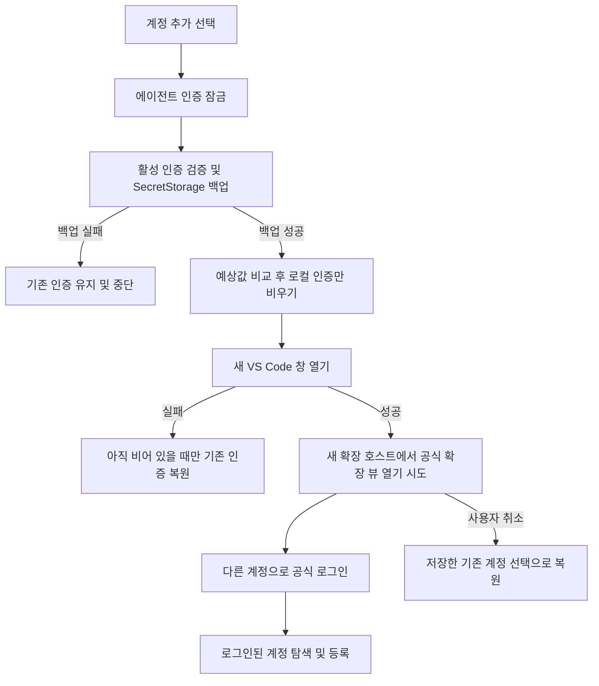

# 로그아웃 없는 새 계정 추가

- 원인: 기존 계정 추가는 이미 완료한 로그인을 저장하는 기능이었다. 다른 계정으로 로그인하려고 공식 확장에서 로그아웃하면 사용자가 보고한 것처럼 저장해 둔 토큰도 무효화될 수 있다. 일반 새 창도 같은 로컬 인증 저장소를 읽으므로 창만 열어서는 해결되지 않는다.
- 수정 범위: 공통 계정 저장·전환, Codex 파일 어댑터, Antigravity Windows 자격 증명 어댑터, 계정 추가 UI와 새 창 인계, 한국어·영어 안내, README, 테스트 실행 명령과 가짜 인증 검증. 기존에 수정 중이던 성능·계정 탐색 기능은 유지했다.

- 백업은 기존 계정 이름을 유지하면서 최신 토큰으로 갱신한다. 미등록 계정도 기본 이름으로 보존한다. 백업 저장 실패는 삼키지 않으며 분리·새 창 열기로 진행하지 않는다. 일반 계정 전환에서 저장 실패까지 무시하던 예외 범위도 인증 형식 검증으로 좁혔다.
- Codex는 보호 검사를 통과하고 백업한 원문과 일치하는 활성 auth.json만 비운다. Antigravity는 예상 자격 증명과 비교한 뒤 Windows CredDeleteW로 gemini:antigravity 항목만 비운다. HTTP·서버 로그아웃·토큰 취소 API를 추가하지 않았다.
- 새 창 열기 실패 시 백업 원문을 복원하되 외부에서 새 로그인이 완료됐다면 덮어쓰지 않는다. 실제 파일·OS 교체 직전에도 기존 예상값 비교를 유지한다.
- 새 창에는 에이전트 ID만 globalState로 인계한다. 토큰을 globalState·명령행·로그에 저장하지 않는다. 설치된 확장 선언에서 해당 에이전트 뷰를 찾아 연다. 뷰가 없거나 열리지 않으면 공식 확장을 직접 여는 안내를 제공한다.
- 파일 가져오기·암호 입력 붙여넣기는 별도 계정 가져오기 메뉴로 유지했다. README는 새 동작과 제약을 한국어 바로 아래 영어 번역으로 기록했다.

검증: 새 보호 검증이 startLogin 부재로 실패하는 것을 먼저 확인했다. 구현 후 포터블 build.ps1 test로 TypeScript 빌드와 기존·신규 assert 검증을 통과했다. 백업→분리→창 순서, 최신 토큰과 이름 보존, 백업 실패 시 중단, 로그인 취소 복원, 창 열기 실패 복구, 외부 로그인 덮어쓰기 방지, 잘못된 인증과 미지원 어댑터 거부, 빈 인증 처리, 파일 예상값·하드 링크 보호, 새 창 인계·뷰 포커스와 가져오기 메뉴 유지를 확인했다. Antigravity 실제 PowerShell은 존재하지 않는 테스트 대상 조회와 예상값 불일치만 검사하므로 쓰기·분리 API까지 도달하지 않는다. 성공 응답은 가짜 프로세스로 검증했다. 소스의 git diff --check도 통과했다.

패키징: 포터블 build.ps1 package가 성공하여 dist/ai-account-switcher-lite-0.1.1.vsix를 생성했다. 출력 목록에서 공통 코드와 두 어댑터·한국어·영어 안내·README 포함 및 테스트·보고서·개발 의존성 제외를 확인했다.

미확인 및 한계: 실제 사용자 토큰·OS 자격 증명은 읽거나 변경하지 않았으며 실제 VS Code 창·공식 로그인·서버 토큰 유효성은 검증하지 않았다. 새 창도 같은 인증 저장소를 공유하므로 계정 동시 사용을 격리하지 않는다. 추가 중 이전 창에서 작업하거나 로그아웃하지 않아야 한다. 인계는 다음에 시작되는 같은 VS Code 프로필 창이 받으므로 동시에 여러 창을 생성하는 경우 대상이 달라질 수 있다. Codex 파일 기반 인증 설정은 기존과 같이 사용자가 선택해야 한다. 이미 만료·취소된 토큰을 백업으로 복구할 수 없고 서버 정책·토큰 갱신에 따른 재로그인 가능성은 남는다.

근거: [OpenAI 인증 문서](https://learn.chatgpt.com/docs/auth)는 CLI·IDE의 인증 캐시 공유와 파일·OS 저장소 구분을 설명한다. [VS Code 공식 명령 문서](https://code.visualstudio.com/api/references/commands)는 vscode.newWindow와 reuseWindow 옵션을 설명한다. 로그아웃이 모든 환경에서 반드시 서버 토큰을 취소한다는 점은 이 문서로 확정하지 않으며, 이 수정은 로그아웃 자체를 호출하지 않도록 한다.
