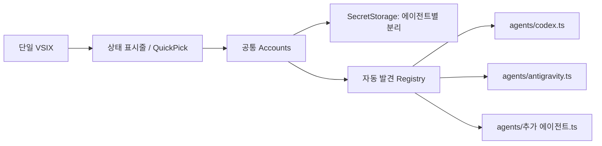

# AI Account Switcher Lite

작성자·배포자: **lightweight** (`lightweight.ai-account-switcher-lite`). 이전 `local-codex-lite` 배포판과는 확장 ID가 다르므로, 기존 확장에 저장한 계정은 새 확장에서 다시 등록해야 합니다. 기존 계정 저장소는 자동 이전되지 않습니다.

**VS Code 확장 하나에서 Codex와 Antigravity 계정을 관리합니다.** 설치 파일은 `ai-account-switcher-lite-0.1.1.vsix` 하나입니다. 에이전트별 인증 어댑터와 계정 저장소는 분리하며, 상태 표시줄·QuickPick만 사용합니다. npm 런타임 의존성은 0개입니다. 등록한 계정이 없는 에이전트는 초기화·메뉴 표시 때 인증 읽기와 OS 보조 프로세스 실행을 생략하며 상태 표시줄의 계정 없음은 저장한 계정이 없다는 뜻입니다.

## 설치와 사용

1. VS Code의 `Extensions: Install from VSIX...`에서 `dist/ai-account-switcher-lite-0.1.1.vsix`를 설치합니다.
2. Codex 또는 공식 Antigravity 확장의 기본 로그인 UI에서 로그인합니다.
3. 해당 상태 표시줄 → **계정 추가** → **현재 계정 등록**을 선택하고 이름을 입력합니다.
4. 다른 계정도 기본 UI로 로그인한 뒤 등록합니다. 새 로그인 전에 현재 계정을 먼저 등록하세요.
5. 해당 에이전트의 상태 표시줄에서 저장한 계정을 선택해 전환합니다.
6. **계정 관리**에서 이름을 바꾸거나 저장한 계정을 삭제합니다. 활성 인증 파일·자격 증명은 삭제하지 않습니다.
7. 이전 세션이 유지되면 알림의 **창 다시 로드**를 선택합니다. 명령 팔레트의 `AI 계정 전환: 계정 전환 / 관리`에서는 에이전트를 먼저 선택할 수 있습니다.

```text
상태 표시줄
$(account) Codex: Personal     $(account) Antigravity: Work

Codex 클릭
✓ Personal
  Work
──────────────
+ 계정 추가
  계정 관리
```

Codex를 클릭하면 Codex 계정만, Antigravity를 클릭하면 Antigravity 계정만 표시합니다. 계정 이름이 같아도 인증이 섞이지 않습니다. Codex에서는 이미 보유한 `auth.json`을 파일로 가져오거나 **계정 추가 → auth.json 붙여넣기**에서 전체 JSON을 붙여넣을 수 있습니다. 붙여넣기는 암호 입력으로 받으며 검증 후 계정 이름과 함께 SecretStorage에 저장합니다. 등록만으로 현재 인증을 바꾸지는 않으며, 저장한 계정을 선택하면 전환됩니다.

새 계정 추가는 기본 로그인 결과를 보관하는 기능입니다. 이 확장이 브라우저 로그인·토큰 갱신·API 요청을 대신 수행하지 않습니다.

## 한국어 / English

`accountSwitcherLite.language` 설정을 바꾸면 재시작 없이 적용됩니다.

| 값 | 표시 언어 |
| --- | --- |
| `auto` | VS Code 표시 언어 |
| `ko` | 한국어 |
| `en` | English |

One extension supports both agents. Set `accountSwitcherLite.language` to `en` for English. Sign in with the agent's own UI, click its status item → **Add Account** → **Register Current Account**, and enter a name. Each agent lists only its own accounts. Select a saved account to switch. **Manage Accounts** provides rename/delete; **Reload Window** applies the session when necessary.

## 지원 범위

### Codex

- VS Code 데스크톱의 로컬 확장 호스트에서 실행됩니다. 원격 워크스페이스에서도 로컬 인증을 다룹니다.
- 확장 호스트 시작 시 전달된 `CODEX_HOME`을 사용하며 기본값은 `~/.codex`입니다. 환경변수를 바꾼 뒤에는 새 환경에서 VS Code를 다시 실행하세요.
- ChatGPT의 `id_token`·`access_token`·`refresh_token`과 사용자 subject·계정 ID, 또는 `OPENAI_API_KEY` 인증을 지원합니다. 인증 JSON 원문 전체를 유지합니다.
- Codex가 OS 키체인 인증을 사용하면 파일 교체가 반영되지 않습니다. 사용자가 Codex `config.toml`의 `cli_auth_credentials_store = "file"`을 선택해야 합니다. 확장이 Codex 설정을 변경하지 않습니다.
- 실행 중인 요청을 마친 뒤 전환하세요. 메모리에 남은 이전 세션은 창 또는 Codex 세션을 다시 열어야 반영될 수 있습니다.

### Antigravity

- **Windows에서 실행되는 공식 Google Antigravity VS Code 확장용**입니다.
- Windows Credential Manager의 `gemini:antigravity` 항목만 읽고 원자적인 `CredWriteW`로 교체합니다. Google ID 토큰과 갱신 토큰이 있는 형식만 지원하며 알 수 없는 추가 자격 증명 속성은 거부합니다.
- Windows 기본 PowerShell과 Windows API를 사용합니다. 별도 npm 런타임 패키지는 없지만 이 어댑터에는 PowerShell 실행 비용과 Windows 의존성이 있습니다. Codex 어댑터는 자식 프로세스를 실행하지 않습니다.
- macOS/Linux의 Antigravity 및 Antigravity 독립 IDE의 SQLite 인증은 지원하지 않으며, 이 환경에서는 Antigravity 상태 표시줄과 메뉴 항목을 표시하지 않습니다. `state.vscdb`를 변경하거나 IDE 프로세스를 종료하지 않습니다.
- 전환 후 공식 확장/백엔드가 이전 인증을 유지하면 창을 다시 로드하거나 VS Code를 완전히 재시작하세요. 실제 Google 로그인·서비스 호출까지는 검증하지 않았습니다.
- 내부 자격 증명 형식을 참고한 구현이며 공식 공개 계정 전환 API가 아닙니다. 형식이 달라지면 안전하게 중단합니다.

## 보안과 오류 처리

- 이름·인증 원문은 에이전트 ID와 인증 경로별 **VS Code SecretStorage**에 함께 저장합니다. 설정·globalState·로그·평문 프로필에는 토큰을 기록하지 않습니다.
- 전환 직전 현재 인증을 해당 프로필에 먼저 저장합니다. 미등록 로그인도 `Account N`으로 보존합니다. 암호화 보존이 실패하면 인증을 교체하지 않습니다.
- 이미 같은 인증을 선택하면 저장·교체를 생략합니다. 목록 검증에서 계산한 식별자는 같은 목록 객체에서 재사용하고, 원문이 바뀌면 다시 검증합니다.
- UTF-8 BOM이 붙은 Codex JSON도 원문을 유지하여 등록합니다. 활성 인증 읽기가 실패해도 계정 추가·관리는 열리며, 인증 전환은 기존 검증을 통과해야 합니다.
- 겹친 상태 갱신 요청은 진행 중인 조회를 공유하고 후속 갱신으로 합칩니다. 에이전트별 조회는 병렬 실행하여 느린 OS 조회가 다른 상태 표시줄을 막지 않습니다.
- 인증 파일은 실제 크기 + 1바이트만 할당하여 EOF까지 읽으며 읽는 동안 크기·수정 시각이 달라지면 중단합니다.
- Codex는 같은 폴더의 배타 생성 임시 파일에 기록하고 `fsync`·`0600` 적용 후 `rename`합니다. 최종 교체 직전 원문이 바뀌었으면 중단합니다. 실패하면 기존 파일을 유지하고 생성한 임시 파일만 정리합니다.
- **Windows의 Node.js chmod는 NTFS DACL을 설정하지 않습니다.** `0600`은 POSIX 권한이며 Windows 인증 폴더는 현재 사용자만 접근 가능한 ACL이어야 합니다. 확장이 임의 폴더 ACL을 바꾸지는 않습니다. Antigravity 자격 증명은 Windows OS 보호를 따릅니다.
- 심볼릭 링크·하드 링크·1 MiB 초과 인증 파일과 잘못된 인증·계정 저장소를 거부합니다. 계정 이름의 제어 문자·아이콘 구문도 거부합니다.
- JWT는 로컬 계정 식별에만 사용합니다. 서명 검증이나 로그인 유효성 확인을 수행하지 않습니다.
- 인증 폴더의 `.account-lite.lock`으로 확장 창끼리 변경을 직렬화합니다. 비정상 종료 후 잠금이 남으면 관련 창을 모두 닫고 낡은 잠금인지 확인한 뒤 사용자가 정리해야 합니다. 자동 잠금 삭제·타이머는 없습니다.
- 외부 에이전트는 이 잠금을 알지 못하므로 최종 비교와 교체 사이의 극히 짧은 경합까지 막지는 못합니다. 로그인·토큰 갱신 중 전환하지 마세요.
- 프로세스 오류에 대비해 보존 후 교체하지만 저장 장치 고장·전원 차단까지 보장하는 트랜잭션은 아닙니다.
- Antigravity 토큰은 PowerShell 명령행·환경변수·임시 파일에 넣지 않고 표준입력으로만 전달합니다. 오류 원문과 자식 프로세스 출력은 로그에 남기지 않습니다.
- Antigravity 보조 프로세스는 최대 15초 뒤 중단하며, 쓰기는 명시적 성공 응답을 확인합니다. 읽기 응답의 형식과 인증 내용도 검증합니다.

## 포터블 빌드

사용자가 제공한 `.tools/.build/nodejs.ps1`을 사용합니다. Windows x64 / PowerShell 5.1 이상에서 시스템 Node.js나 전역 PATH 변경 없이 실행합니다.

```powershell
.\build.ps1 prepare   # 최초 SDK 다운로드·SHA-256 검증 및 개발 의존성 준비
.\build.ps1 build     # TypeScript 컴파일
.\build.ps1 test      # 실제 인증에 접근하지 않는 assert 검증
.\build.ps1 package   # Codex와 Antigravity가 들어 있는 VSIX 하나 생성
```

- SDK·npm 캐시는 `.tools/.build/nodejs/`, 개발 라이브러리는 프로젝트 `node_modules/`에 둡니다. 프로젝트 전체를 함께 이동하면 사용할 수 있습니다.
- 준비 후 빌드·검증·패키징은 다운로드를 요청하지 않습니다. `prepare -Offline`은 SDK와 npm 캐시가 있을 때만 가능합니다.
- 제공 도구의 `prime`에서 Windows 파일 잠금으로 라이브러리 이동이 실패하여, 래퍼는 라이브러리를 이동하지 않고 현재 위치에서 사용합니다. 기존 파일을 자동 삭제하지 않습니다.
- 테스트 전용 코드와 가짜 인증·산출물은 `.tools/.test/`에만 둡니다. 실제 사용자 인증·OS 자격 증명을 변경하지 않습니다.
- `.tools/.test/check.cjs`는 계정 기능·오류 보호·동시 잠금·언어·UI·금지 기능을 검증합니다. Windows API는 존재하지 않는 테스트 대상 읽기만 수행하고 쓰기는 모의 경계로 검증합니다. POSIX의 `0600`·심볼릭 링크 검사는 해당 OS에서 실행될 때 수행합니다.
- `.tools/.test/vsix.ps1`은 **VSIX 하나에 모든 어댑터가 포함되는지**, 개발 파일과 런타임 의존성이 배제되는지 검사합니다.
- `.tools/.test/portable.cjs`는 다른 경로에 읽기 전용 입력을 복제하고 시스템 Node PATH 없이 npm 오프라인 모드·사용 불가 레지스트리/프록시로 패키징을 검사합니다. OS 방화벽으로 네트워크를 완전히 차단한 검증과는 다릅니다.
- 일반 Node.js 환경에서는 `npm ci --ignore-scripts`, `npm test`, `npm run package`도 사용할 수 있습니다.

VSIX에는 컴파일된 JS·매니페스트·번역·README·라이선스만 포함합니다. SDK·개발 의존성·원본 참조 저장소·테스트·보고서는 제외됩니다.

## 에이전트 확장 구조

**Strategy**가 인증 저장·식별 방식을 분리하고 **Registry**가 `agents/` 파일을 자동 발견합니다. UI와 SecretStorage 보존 순서는 공통입니다.



1. `src/agents/<id>.ts`를 추가하고 `default`로 `Agent` 객체를 내보냅니다. 파일명과 `id`를 맞춥니다.
2. `id`, `label`, 잠금·저장소 구분용 `authPath`, `identify(raw)`, `read()`, `replace(raw, expected)`를 구현합니다.
3. `identify`는 입력을 검증하고 갱신에도 유지되는 계정 식별자를 반환합니다. `replace`는 예상 인증과 일치할 때만 원자적으로 교체하며 실패 시 원본을 보존해야 합니다.
4. 필요하면 `supportsHost(appName)`으로 호스트를 제한하거나 `importFile: true`로 파일 가져오기를 표시합니다.
5. 빌드하면 새 어댑터가 **같은 VSIX**에 자동 포함됩니다. 중앙 등록·UI·패키징 목록을 수정할 필요는 없습니다. 새 저장 형식의 보호 검증은 추가하세요.

## 경량화와 출처

사용량·Rate Limit·HTTP/API·텔레메트리·자동 갱신·주기 타이머·백그라운드 작업·Webview·사이드바·CLI/app-server 실행은 포함하지 않습니다. Antigravity의 요청 시점 OS 자격 증명 접근을 위한 PowerShell 호출만 존재합니다. 에이전트 자체 로그인·서비스 통신은 수정하지 않습니다.

[WoozyMasta/codex-switch](https://github.com/WoozyMasta/codex-switch)의 경로 해석·계정 식별·활성 인증 보존을 분석해 최소 구조로 재구현했습니다. Windows 자격 증명 형식은 [BoyGR/antigravity-account-switcher](https://github.com/BoyGR/antigravity-account-switcher)를 참고했습니다. MIT 저작권 고지는 `LICENSE`, 상세 출처는 `NOTICE.md`에 유지합니다.

검증 결과와 남은 제약은 `.docs/` 작업 보고서에 기록합니다. 실제 VS Code 메모리 증가량은 측정하지 않았습니다.
