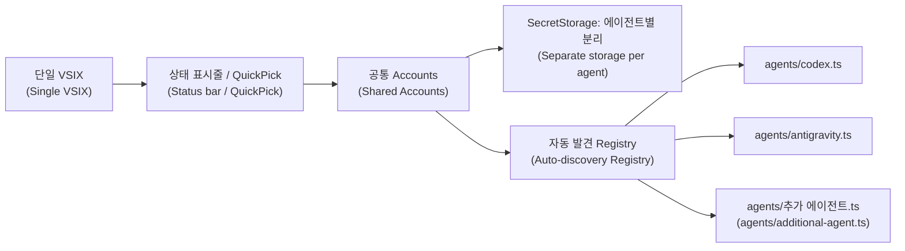

# AI Account Switcher Lite

작성자·배포자: **lightweight** (`lightweight.ai-account-switcher-lite`). 이전 `local-codex-lite` 배포판과는 확장 ID가 다르므로, 기존 확장에 저장한 계정은 새 확장에서 다시 등록해야 합니다. 기존 계정 저장소는 자동 이전되지 않습니다.  
(Author and publisher: **lightweight** (`lightweight.ai-account-switcher-lite`). This extension has a different ID from the previous `local-codex-lite` distribution, so accounts saved in the old extension must be registered again. Existing account storage is not migrated automatically.)

**VS Code 확장 하나에서 Codex와 Antigravity 계정을 관리합니다.** 설치 파일은 `ai-account-switcher-lite-1.0.0.vsix` 하나입니다. 에이전트별 인증 어댑터와 계정 저장소는 분리하며, 상태 표시줄·QuickPick만 사용합니다. npm 런타임 의존성은 0개입니다. 등록한 계정이 없는 에이전트는 초기화·메뉴 표시 때 인증 읽기와 OS 보조 프로세스 실행을 생략하며 상태 표시줄의 계정 없음은 저장한 계정이 없다는 뜻입니다.  
(**Manage Codex and Antigravity accounts in one VS Code extension.** A single `ai-account-switcher-lite-1.0.0.vsix` installs both. Authentication adapters and account storage are separate for each agent; the UI uses only the status bar and QuickPick. There are zero npm runtime dependencies. Agents with no registered accounts skip authentication reads and OS helper processes during initialization and menu display. “No accounts” in the status bar means no accounts have been saved.)

## 설치와 사용
(Installation and Usage)

1. VS Code의 `Extensions: Install from VSIX...`에서 `dist/ai-account-switcher-lite-1.0.0.vsix`를 설치합니다.  
   (Install `dist/ai-account-switcher-lite-1.0.0.vsix` using VS Code's `Extensions: Install from VSIX...` command.)
2. 처음에는 Codex 또는 공식 Antigravity 확장의 기본 UI에서 로그인하고, 상태 표시줄 → **로그인된 계정 탐색 및 등록**으로 저장합니다.  
   (For your first account, sign in through Codex or the official Antigravity extension's own UI, then save it using the status bar → **Detect Logged-in Account**.)
3. 다른 계정을 추가하려면 실행 중인 요청을 마친 뒤 **계정 추가**를 선택합니다. 현재 인증을 SecretStorage에 먼저 백업하고 로컬 인증만 비운 뒤 새 VS Code 창을 엽니다. 서버 로그아웃 명령은 호출하지 않습니다.  
   (To add another account, finish active requests and select **Add Account**. Current authentication is backed up in SecretStorage before only the local credentials are cleared and a new VS Code window is opened. No server sign-out command is called.)
4. 새 창에서 공식 확장의 로그인 화면으로 다른 계정에 로그인한 뒤 **로그인된 계정 탐색 및 등록**으로 저장합니다. 이전 창에서는 작업·로그아웃을 하지 마세요. 로그인을 취소했다면 저장한 기존 계정을 선택해 복원할 수 있습니다.  
   (In the new window, sign in to another account through the official extension's login screen, then save it using **Detect Logged-in Account**. Avoid running requests or signing out in the previous window. If you cancel login, select your previously saved account to restore it.)
5. 해당 에이전트의 상태 표시줄에서 저장한 계정을 선택해 전환합니다.  
   (Select a saved account from the agent's status bar item to switch.)
6. **계정 관리**에서 이름을 바꾸거나 저장한 계정을 삭제합니다. 활성 인증 파일·자격 증명은 삭제하지 않습니다.  
   (Use **Manage Accounts** to rename or delete saved accounts. Active authentication files and credentials are not deleted.)
7. 이전 세션이 유지되면 알림의 **창 다시 로드**를 선택합니다. 명령 팔레트의 `AI 계정 전환: 계정 전환 / 관리`에서는 에이전트를 먼저 선택할 수 있습니다.  
   (If the previous session remains active, select **Reload Window** in the notification. The command palette's `AI Account Switcher: Switch / Manage Accounts` command lets you select an agent first.)

```text
상태 표시줄
(Status bar)
$(account) Codex: Personal     $(account) Antigravity: Work

Codex 클릭
(Click Codex)
✓ Personal
  Work
──────────────
🔍 로그인된 계정 탐색 및 등록
(🔍 Discover and Register Logged-in Account)
+ 계정 추가
(+ Add Account)
  계정 관리
(Manage Accounts)
```

Codex를 클릭하면 Codex 계정만, Antigravity를 클릭하면 Antigravity 계정만 표시합니다. 계정 이름이 같아도 인증이 섞이지 않습니다. Codex에서는 **계정 가져오기 (파일 / 붙여넣기)**로 이미 보유한 `auth.json`을 가져오거나 전체 JSON을 붙여넣을 수 있습니다. 붙여넣기는 암호 입력으로 받으며 검증 후 계정 이름과 함께 SecretStorage에 저장합니다. 탐색·가져오기는 현재 인증을 바꾸지 않으며, 저장한 계정을 선택하면 전환됩니다.  
(Clicking Codex shows only Codex accounts; clicking Antigravity shows only Antigravity accounts. Authentication stays separate even when account names match. For Codex, use **Import Account (file / paste)** to import an existing `auth.json` or paste the entire JSON. Pasted content uses a masked input and is validated before being saved with the account name in SecretStorage. Detection and import leave active authentication unchanged; selecting a saved account switches it.)

계정 추가는 기존 인증 백업과 로그아웃 없는 새 로그인 준비를 담당합니다. Codex는 활성 `auth.json`, Antigravity는 Windows Credential Manager의 `gemini:antigravity` 항목만 로컬에서 비웁니다. 새 창에서는 설치된 확장의 뷰를 찾아 열며 자동으로 열리지 않으면 공식 확장을 직접 여세요. 실제 브라우저 로그인·토큰 갱신·API 요청은 공식 에이전트가 수행합니다. 브라우저가 기존 계정을 자동 선택하면 다른 계정이나 별도 브라우저 프로필을 사용하세요.  
(Add Account backs up existing authentication and prepares a new login without signing out. It locally clears only Codex's active `auth.json` or Antigravity's `gemini:antigravity` entry in Windows Credential Manager. The new window attempts to open the installed extension's view; open the official extension manually if needed. The official agent handles browser login, token refreshes, and API requests. If your browser automatically selects the previous account, choose another account or use a separate browser profile.)

새 창은 별도 계정 저장소가 아니므로 여러 계정을 동시에 사용하기 위한 격리 기능은 아닙니다. 백업은 이미 로그아웃·만료·취소된 토큰을 되살리지 않으며, 서버 정책과 토큰 갱신에 따른 재로그인 필요성은 남습니다.  
(The new window shares the authentication store and does not isolate accounts for simultaneous use. A backup cannot revive tokens already invalidated by sign-out, expiration, or revocation; server policies and token refreshes can still require signing in again.)

## 한국어 / English
(Korean / English)

`accountSwitcherLite.language` 설정을 바꾸면 재시작 없이 적용됩니다.  
(Changes to `accountSwitcherLite.language` take effect without restarting.)

| 값<br>(Value) | 표시 언어<br>(Display language) |
| --- | --- |
| `auto` | VS Code 표시 언어<br>(VS Code display language) |
| `ko` | 한국어<br>(Korean) |
| `en` | English |

One extension supports both agents. Set `accountSwitcherLite.language` to `en` for English. Save your first login with **Detect Logged-in Account**. To add another account, choose **Add Account** to back up existing authentication and open a new window without signing out. Sign in there and save the new account with **Detect Logged-in Account**. Each agent lists only its own accounts. Select a saved account to switch or restore after canceling login. **Manage Accounts** provides rename/delete; **Reload Window** applies the session when necessary.

## 지원 범위
(Supported Environments)

### Codex

- VS Code 데스크톱의 로컬 확장 호스트에서 실행됩니다. 원격 워크스페이스에서도 로컬 인증을 다룹니다.  
  (Runs in the local extension host of VS Code desktop. Authentication remains local even in remote workspaces.)
- 확장 호스트 시작 시 전달된 `CODEX_HOME`을 사용하며 기본값은 `~/.codex`입니다. 환경변수를 바꾼 뒤에는 새 환경에서 VS Code를 다시 실행하세요.  
  (Uses `CODEX_HOME` passed to the extension host at startup, defaulting to `~/.codex`. After changing the environment variable, relaunch VS Code from the updated environment.)
- ChatGPT의 `id_token`·`access_token`·`refresh_token`과 사용자 subject·계정 ID, 또는 `OPENAI_API_KEY` 인증을 지원합니다. 인증 JSON 원문 전체를 유지합니다.  
  (Supports ChatGPT authentication with `id_token`, `access_token`, `refresh_token`, user subject and account ID, or authentication using `OPENAI_API_KEY`. The entire original authentication JSON is preserved.)
- Codex가 OS 키체인 인증을 사용하면 파일 교체가 반영되지 않습니다. 사용자가 Codex `config.toml`의 `cli_auth_credentials_store = "file"`을 선택해야 합니다. 확장이 Codex 설정을 변경하지 않습니다.  
  (If Codex uses the OS keychain, replacing the file has no effect. Set `cli_auth_credentials_store = "file"` in Codex's `config.toml` yourself. This extension does not change Codex settings.)
- 실행 중인 요청을 마친 뒤 전환하세요. 메모리에 남은 이전 세션은 창 또는 Codex 세션을 다시 열어야 반영될 수 있습니다.  
  (Finish active requests before switching. You may need to reopen the window or Codex session to replace a previous session held in memory.)

### Antigravity

- **Windows에서 실행되는 공식 Google Antigravity VS Code 확장용**입니다.  
  (For the **official Google Antigravity VS Code extension running on Windows**.)
- Windows Credential Manager의 `gemini:antigravity` 항목만 읽고 원자적인 `CredWriteW`로 교체합니다. Google ID 토큰과 갱신 토큰이 있는 형식만 지원하며 알 수 없는 추가 자격 증명 속성은 거부합니다.  
  (Reads only the `gemini:antigravity` entry in Windows Credential Manager and replaces it atomically with `CredWriteW`. Only formats containing Google ID and refresh tokens are supported; unknown additional credential attributes are rejected.)
- Windows 기본 PowerShell과 Windows API를 사용합니다. 별도 npm 런타임 패키지는 없지만 이 어댑터에는 PowerShell 실행 비용과 Windows 의존성이 있습니다. Codex 어댑터는 자식 프로세스를 실행하지 않습니다.  
  (Uses Windows PowerShell and Windows APIs. There are no additional npm runtime packages, but this adapter incurs PowerShell startup overhead and depends on Windows. The Codex adapter does not launch child processes.)
- macOS/Linux의 Antigravity 및 Antigravity 독립 IDE의 SQLite 인증은 지원하지 않으며, 이 환경에서는 Antigravity 상태 표시줄과 메뉴 항목을 표시하지 않습니다. `state.vscdb`를 변경하거나 IDE 프로세스를 종료하지 않습니다.  
  (Antigravity on macOS/Linux and SQLite authentication in the standalone Antigravity IDE are unsupported. Antigravity status bar and menu items are hidden in those environments. The extension does not modify `state.vscdb` or terminate IDE processes.)
- 전환 후 공식 확장/백엔드가 이전 인증을 유지하면 창을 다시 로드하거나 VS Code를 완전히 재시작하세요. 실제 Google 로그인·서비스 호출까지는 검증하지 않았습니다.  
  (If the official extension or backend retains the previous authentication after switching, reload the window or fully restart VS Code. Actual Google login and service calls have not been verified.)
- 내부 자격 증명 형식을 참고한 구현이며 공식 공개 계정 전환 API가 아닙니다. 형식이 달라지면 안전하게 중단합니다.  
  (The implementation references an internal credential format rather than an official public account-switching API. It stops safely if the format changes.)

## 보안과 오류 처리
(Security and Error Handling)

- 이름·인증 원문은 에이전트 ID와 인증 경로별 **VS Code SecretStorage**에 함께 저장합니다. 설정·globalState·로그·평문 프로필에는 토큰을 기록하지 않습니다.  
  (Names and original authentication content are stored together in **VS Code SecretStorage**, separated by agent ID and authentication path. Tokens are not written to settings, globalState, logs, or plaintext profiles.)
- 전환 직전 현재 인증을 해당 프로필에 먼저 저장합니다. 미등록 로그인도 `Account N`으로 보존합니다. 암호화 보존이 실패하면 인증을 교체하지 않습니다.  
  (Immediately before switching, current authentication is saved to its profile. Unregistered logins are also preserved as `Account N`. If encrypted preservation fails, authentication is not replaced.)
- 계정 추가도 같은 잠금 안에서 백업 → 로컬 인증 분리 → 새 창 열기 순서를 지킵니다. 백업 실패 시 분리하지 않으며, 새 창 열기 실패 시 아직 비어 있는 인증만 복원해 외부 로그인을 덮어쓰지 않습니다.  
  (Add Account uses the same lock for backup → local credential clearing → opening a new window. A failed backup prevents clearing. If opening the window fails, authentication is restored only while the store remains empty, preserving any external login.)
- 같은 계정을 선택해도 인증을 교체하여 세션 재연결을 돕습니다. 목록 검증에서 계산한 식별자는 같은 목록 객체에서 재사용하고, 원문이 바뀌면 다시 검증합니다.  
  (Selecting the same account still replaces authentication to help reconnect the session. Identifiers calculated during list validation are reused for the same list object; changed source content is validated again.)
- UTF-8 BOM이 붙은 Codex JSON도 원문을 유지하여 등록합니다. 활성 인증 읽기가 실패해도 계정 추가·관리는 열리며, 인증 전환은 기존 검증을 통과해야 합니다.  
  (Codex JSON with a UTF-8 BOM can be registered without altering the original content. Adding and managing accounts remain available if active authentication cannot be read; switching must still pass the existing validation.)
- 겹친 상태 갱신 요청은 진행 중인 조회를 공유하고 후속 갱신으로 합칩니다. 에이전트별 조회는 병렬 실행하여 느린 OS 조회가 다른 상태 표시줄을 막지 않습니다.  
  (Overlapping status updates share the active lookup and are coalesced into a follow-up update. Agent lookups run in parallel so slow OS lookups do not block other status bar items.)
- 인증 파일은 실제 크기 + 1바이트만 할당하여 EOF까지 읽으며 읽는 동안 크기·수정 시각이 달라지면 중단합니다.  
  (Authentication files are read to EOF with an allocation of only their actual size plus one byte. Reading stops if the size or modification time changes.)
- Codex는 같은 폴더의 배타 생성 임시 파일에 기록하고 `fsync`·`0600` 적용 후 `rename`합니다. 최종 교체 직전 원문이 바뀌었으면 중단합니다. 실패하면 기존 파일을 유지하고 생성한 임시 파일만 정리합니다.  
  (Codex writes to an exclusively created temporary file in the same folder, applies `fsync` and `0600`, then uses `rename`. It stops if the original content changes immediately before replacement. On failure, the existing file is preserved and only the temporary file it created is cleaned up.)
- **Windows의 Node.js chmod는 NTFS DACL을 설정하지 않습니다.** `0600`은 POSIX 권한이며 Windows 인증 폴더는 현재 사용자만 접근 가능한 ACL이어야 합니다. 확장이 임의 폴더 ACL을 바꾸지는 않습니다. Antigravity 자격 증명은 Windows OS 보호를 따릅니다.  
  (**Node.js chmod on Windows does not set NTFS DACLs.** `0600` represents POSIX permissions; the Windows authentication folder must have an ACL allowing access only to the current user. The extension does not change arbitrary folder ACLs. Antigravity credentials use Windows OS protection.)
- 심볼릭 링크·하드 링크·1 MiB 초과 인증 파일과 잘못된 인증·계정 저장소를 거부합니다. 계정 이름의 제어 문자·아이콘 구문도 거부합니다.  
  (Rejects symbolic links, hard links, authentication files larger than 1 MiB, and invalid authentication or account storage. Control characters and icon syntax in account names are also rejected.)
- JWT는 로컬 계정 식별에만 사용합니다. 서명 검증이나 로그인 유효성 확인을 수행하지 않습니다.  
  (JWTs are used only for local account identification. Signatures and login validity are not verified.)
- 인증 폴더의 `.account-lite.lock`으로 확장 창끼리 변경을 직렬화합니다. 비정상 종료 후 잠금이 남으면 관련 창을 모두 닫고 낡은 잠금인지 확인한 뒤 사용자가 정리해야 합니다. 자동 잠금 삭제·타이머는 없습니다.  
  (Changes across extension windows are serialized using `.account-lite.lock` in the authentication folder. If a lock remains after an abnormal exit, close all related windows, confirm it is stale, and clean it up manually. There is no automatic lock deletion or timer.)
- 외부 에이전트는 이 잠금을 알지 못하므로 최종 비교와 교체 사이의 극히 짧은 경합까지 막지는 못합니다. 로그인·토큰 갱신 중 전환하지 마세요.  
  (External agents do not honor this lock, so it cannot prevent the very brief race between the final comparison and replacement. Do not switch during login or token refresh.)
- 프로세스 오류에 대비해 보존 후 교체하지만 저장 장치 고장·전원 차단까지 보장하는 트랜잭션은 아닙니다.  
  (Authentication is preserved before replacement to protect against process errors, but this is not a transaction that guarantees recovery from storage failure or power loss.)
- Antigravity 토큰은 PowerShell 명령행·환경변수·임시 파일에 넣지 않고 표준입력으로만 전달합니다. 오류 원문과 자식 프로세스 출력은 로그에 남기지 않습니다.  
  (Antigravity tokens are passed only through standard input, never through PowerShell command lines, environment variables, or temporary files. Raw errors and child process output are not logged.)
- Antigravity 보조 프로세스는 최대 15초 뒤 중단하며, 쓰기는 명시적 성공 응답을 확인합니다. 읽기 응답의 형식과 인증 내용도 검증합니다.  
  (Antigravity helper processes are stopped after at most 15 seconds, and writes require an explicit success response. Read response formats and authentication content are also validated.)

## 포터블 빌드
(Portable Build)

사용자가 제공한 `.tools/.build/nodejs.ps1`을 사용합니다. Windows x64 / PowerShell 5.1 이상에서 시스템 Node.js나 전역 PATH 변경 없이 실행합니다.  
(Uses the user-provided `.tools/.build/nodejs.ps1`. Runs on Windows x64 with PowerShell 5.1 or later without requiring system Node.js or changing the global PATH.)

```powershell
.\build.ps1 prepare   # 최초 SDK 다운로드·SHA-256 검증 및 개발 의존성 준비
# (Download the SDK, verify SHA-256, and prepare development dependencies on first use)
.\build.ps1 build     # TypeScript 컴파일
# (Compile TypeScript)
.\build.ps1 test      # 실제 인증에 접근하지 않는 assert 검증
# (Run assert checks without accessing real authentication)
.\build.ps1 package   # Codex와 Antigravity가 들어 있는 VSIX 하나 생성
# (Create one VSIX containing Codex and Antigravity)
```

- SDK·npm 캐시는 `.tools/.build/nodejs/`, 개발 라이브러리는 프로젝트 `node_modules/`에 둡니다. 프로젝트 전체를 함께 이동하면 사용할 수 있습니다.  
  (SDK and npm caches are stored in `.tools/.build/nodejs/`; development libraries are stored in the project's `node_modules/`. Move the entire project together to keep it usable.)
- 준비 후 빌드·검증·패키징은 다운로드를 요청하지 않습니다. `prepare -Offline`은 SDK와 npm 캐시가 있을 때만 가능합니다.  
  (After preparation, build, verification, and packaging do not request downloads. `prepare -Offline` requires an existing SDK and npm cache.)
- 제공 도구의 `prime`에서 Windows 파일 잠금으로 라이브러리 이동이 실패하여, 래퍼는 라이브러리를 이동하지 않고 현재 위치에서 사용합니다. 기존 파일을 자동 삭제하지 않습니다.  
  (Windows file locking prevented the supplied tool's `prime` step from moving libraries, so the wrapper uses them in place. Existing files are not deleted automatically.)
- 테스트 전용 코드와 가짜 인증·산출물은 `.tools/.test/`에만 둡니다. 실제 사용자 인증·OS 자격 증명을 변경하지 않습니다.  
  (Test-only code, fake authentication, and test artifacts stay under `.tools/.test/`. Real user authentication and OS credentials are not modified.)
- `.tools/.test/check.cjs`는 보조 프로세스 재사용·오류 복구·상태 갱신을, `.tools/.test/new-login.cjs`는 새 로그인 백업·실패 복구·인증 충돌·UI 인계를 검증합니다. Windows API는 존재하지 않는 테스트 대상 조회와 쓰기·분리 전 충돌 검증만 수행하며, 실제 사용자 인증·자격 증명은 변경하지 않습니다.  
  (`.tools/.test/check.cjs` checks helper process reuse, error recovery, and status updates; `.tools/.test/new-login.cjs` checks new-login backups, failure recovery, credential conflicts, and UI handoff. Windows API checks only query a nonexistent test target and verify conflicts before writes or clearing. Real user authentication and credentials are not changed.)
- `.tools/.test/vsix.ps1`은 **VSIX 하나에 모든 어댑터가 포함되는지**, 개발 파일과 런타임 의존성이 배제되는지 검사합니다.  
  (`.tools/.test/vsix.ps1` checks that **all adapters are included in one VSIX** and that development files and runtime dependencies are excluded.)
- `.tools/.test/portable.cjs`는 다른 경로에 읽기 전용 입력을 복제하고 시스템 Node PATH 없이 npm 오프라인 모드·사용 불가 레지스트리/프록시로 패키징을 검사합니다. OS 방화벽으로 네트워크를 완전히 차단한 검증과는 다릅니다.  
  (`.tools/.test/portable.cjs` copies read-only inputs to another path and checks packaging without system Node on PATH, using npm offline mode and an unavailable registry/proxy. This does not amount to verification with all network access blocked by an OS firewall.)
- 일반 Node.js 환경에서는 `npm ci --ignore-scripts`, `npm test`, `npm run package`도 사용할 수 있습니다.  
  (In a standard Node.js environment, `npm ci --ignore-scripts`, `npm test`, and `npm run package` are also available.)

VSIX에는 컴파일된 JS·매니페스트·번역·README·라이선스만 포함합니다. SDK·개발 의존성·원본 참조 저장소·테스트·보고서는 제외됩니다.  
(The VSIX includes only compiled JavaScript, manifests, translations, README, and licenses. SDKs, development dependencies, upstream reference repositories, tests, and reports are excluded.)

## 에이전트 확장 구조
(Agent Extension Architecture)

**Strategy**가 인증 저장·식별 방식을 분리하고 **Registry**가 `agents/` 파일을 자동 발견합니다. UI와 SecretStorage 보존 순서는 공통입니다.  
(**Strategy** separates authentication storage and identification, while **Registry** automatically discovers files in `agents/`. The UI and SecretStorage preservation sequence are shared.)



1. `src/agents/<id>.ts`를 추가하고 `default`로 `Agent` 객체를 내보냅니다. 파일명과 `id`를 맞춥니다.  
   (Add `src/agents/<id>.ts` and export an `Agent` object as `default`. Match the filename to `id`.)
2. `id`, `label`, 잠금·저장소 구분용 `authPath`, `identify(raw)`, `read()`, `replace(raw, expected)`를 구현합니다.  
   (Implement `id`, `label`, `authPath` for separating locks and storage, `identify(raw)`, `read()`, and `replace(raw, expected)`.)
3. `identify`는 입력을 검증하고 갱신에도 유지되는 계정 식별자를 반환합니다. `replace`는 예상 인증과 일치할 때만 원자적으로 교체하며 실패 시 원본을 보존해야 합니다.  
   (`identify` validates input and returns an account identifier that remains stable across refreshes. `replace` must replace authentication atomically only when it matches the expected content, preserving the original on failure.)
   로그아웃 없는 계정 추가를 지원하려면 `clear(expected)`를 구현해 예상값과 일치하는 로컬 인증만 비우세요. 서버 로그아웃·토큰 취소는 호출하지 않아야 합니다.  
   (To support adding accounts without signing out, implement `clear(expected)` to clear only matching local authentication. Do not call server sign-out or token revocation.)
4. 필요하면 `supportsHost(appName)`으로 호스트를 제한하거나 `importFile: true`로 파일 가져오기를 표시합니다.  
   (If needed, restrict the host with `supportsHost(appName)` or enable file import with `importFile: true`.)
5. 빌드하면 새 어댑터가 **같은 VSIX**에 자동 포함됩니다. 중앙 등록·UI·패키징 목록을 수정할 필요는 없습니다. 새 저장 형식의 보호 검증은 추가하세요.  
   (Building automatically includes the new adapter in **the same VSIX**. No changes to central registration, UI, or packaging lists are needed. Add protection checks for the new storage format.)

## 경량화와 출처
(Lightweight Design and Credits)

사용량·Rate Limit·HTTP/API·텔레메트리·자동 갱신·주기 타이머·백그라운드 작업·Webview·사이드바·CLI/app-server 실행은 포함하지 않습니다. Antigravity의 요청 시점 OS 자격 증명 접근을 위한 PowerShell 호출만 존재합니다. 에이전트 자체 로그인·서비스 통신은 수정하지 않습니다.  
(Usage tracking, rate-limit monitoring, HTTP/API calls, telemetry, automatic refreshes, periodic timers, background jobs, Webviews, sidebars, and CLI/app-server execution are not included. The only PowerShell calls access Antigravity OS credentials on demand. The agents' own login and service communication are unchanged.)

[WoozyMasta/codex-switch](https://github.com/WoozyMasta/codex-switch)의 경로 해석·계정 식별·활성 인증 보존을 분석해 최소 구조로 재구현했습니다. Windows 자격 증명 형식은 [BoyGR/antigravity-account-switcher](https://github.com/BoyGR/antigravity-account-switcher)를 참고했습니다. MIT 저작권 고지는 `LICENSE`, 상세 출처는 `NOTICE.md`에 유지합니다.  
(Path resolution, account identification, and active authentication preservation were analyzed in [WoozyMasta/codex-switch](https://github.com/WoozyMasta/codex-switch) and reimplemented with a minimal structure. The Windows credential format references [BoyGR/antigravity-account-switcher](https://github.com/BoyGR/antigravity-account-switcher). MIT copyright notices remain in `LICENSE`; detailed attribution is in `NOTICE.md`.)

검증 결과와 남은 제약은 `.docs/` 작업 보고서에 기록합니다. 실제 VS Code 메모리 증가량은 측정하지 않았습니다.  
(Verification results and remaining limitations are recorded in task reports under `.docs/`. Actual VS Code memory overhead has not been measured.)
